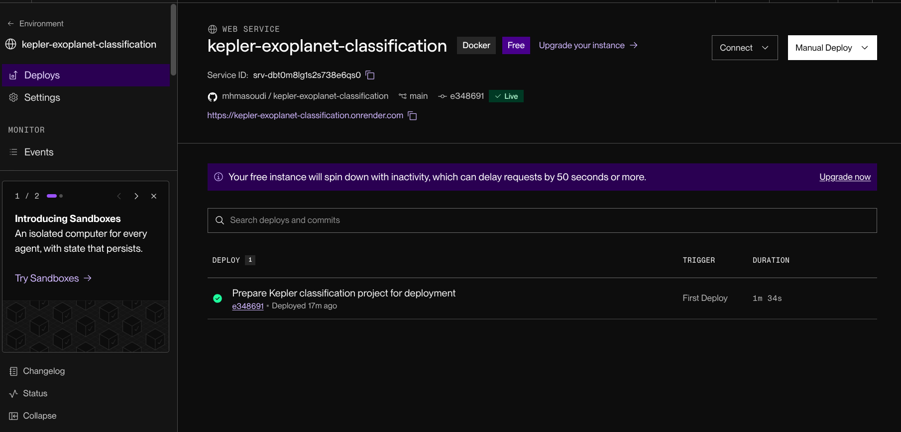
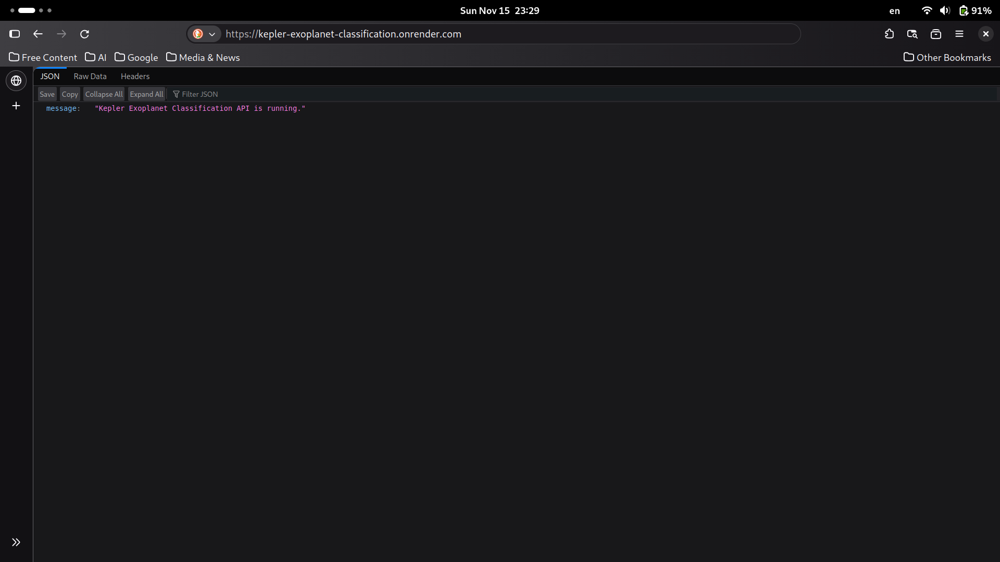
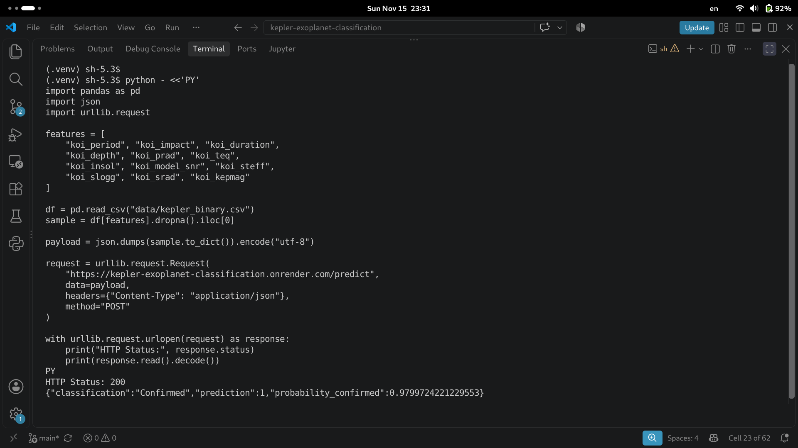

# Kepler Exoplanet Candidate Classification

## Project Overview

In this project, I explore how machine learning could be used to distinguish confirmed exoplanets in data collected by NASA's Kepler mission from false positives.


After training and comparison of multiple models based on the observed features of Kepler Objects of Interests (KOIs), I have chosen a final one and deployed it as a REST API.

## Dataset

The dataset comes from the NASA Exoplanet Archive's Cumulative Kepler Objects of Interest (KOI) table.

- **Source:** [NASA Exoplanet Archive](https://exoplanetarchive.ipac.caltech.edu/)
- **Observations:** 7,587
- **Predictive features:** 12 numerical features
- **Target:** Binary classification
  - `0`: False Positive
  - `1`: Confirmed

The features describe different aspects of the candidates, including their orbital properties, planetary characteristics, and host stars.

I retained the host-star identifier (kepid) to group observations during data splitting. It was not used as a predictive feature.

## Exploratory Data Analysis

Before training the models, I explored the dataset to get a better understanding of its features and structure.

The analysis included:

- Examining feature distributions
- Looking at relationships between numerical features
- Checking missing values
- Exploring correlations between features
- Comparing confirmed planets with false positives
- Investigating multiple observations associated with the same host star

## Model Training

I compared four classification algorithms:

1. Logistic Regression
2. Decision Tree
3. Random Forest
4. XGBoost

I evaluated the models using accuracy, precision, recall, F1-score, and ROC-AUC. I also performed hyperparameter tuning to improve their performance.

One important consideration was that multiple observations can belong to the same host star. To reduce the risk of data leakage, I used `kepid` to group observations when splitting the data.

### Final Model

After comparing the models, I selected the tuned XGBoost classifier.

Its performance on the test set was:

| Metric | Score |
|---|---:|
| Accuracy | 0.9241 |
| Precision | 0.8861 |
| Recall | 0.8930 |
| F1-score | 0.8895 |
| ROC-AUC | 0.9722 |

The trained model is saved in `models/kepler_xgboost.joblib`.

## Project Structure

```text
kepler-exoplanet-classification/
├── data/
│   └── kepler_binary.csv
├── models/
│   └── kepler_xgboost.joblib
├── notebooks/
│   ├── 01_eda.ipynb
│   └── 02_modeling.ipynb
├── screenshots/
├── src/
│   ├── app.py
│   ├── predict.py
│   └── train.py
├── Dockerfile
├── requirements.txt
├── README.md
└── .gitignore
```

## Running the Project Locally

To get a local copy of the project, clone the repository and install its dependencies:

```bash
git clone https://github.com/mhmasoudi/kepler-exoplanet-classification.git
cd kepler-exoplanet-classification
pip install -r requirements.txt
```
To train the model:

```bash
python src/train.py
```

To run predictions using the saved model:

```bash
python src/predict.py
```

## API Deployment

I used Flask to build the prediction API, Gunicorn to serve the application, and Docker to package it for deployment.

The application is deployed on Render and can be accessed here:

**Public API:** https://kepler-exoplanet-classification.onrender.com/

Note: The API is hosted on Render's free tier, so the service may spin down after a period of inactivity. The first request after that may take a little longer while the service starts up.

### Available Endpoints

| Method | Endpoint | Description |
|---|---|---|
| GET | `/` | API health check |
| POST | `/predict` | Predicts the candidate classification |

### Example Request

The `/predict` endpoint expects a JSON object containing all 12 input features.

For example:

```bash
curl -X POST https://kepler-exoplanet-classification.onrender.com/predict \
  -H "Content-Type: application/json" \
  -d '{
    "koi_period": 9.488036,
    "koi_impact": 0.146,
    "koi_duration": 2.9575,
    "koi_depth": 615.8,
    "koi_prad": 1.12,
    "koi_teq": 793,
    "koi_insol": 93.59,
    "koi_model_snr": 35.8,
    "koi_steff": 5455,
    "koi_slogg": 4.467,
    "koi_srad": 0.927,
    "koi_kepmag": 12.214
  }'
```

### Example Response

```json
{
  "classification": "Confirmed",
  "prediction": 1,
  "probability_confirmed": 0.9799724221229553
}
```

The `probability_confirmed` field gives the model's estimated probability that the candidate belongs to the confirmed class.

### Running with Docker

To build the Docker image:

```bash
docker build -t kepler-classifier .
```

Then start the container:

```bash
docker run -p 5000:5000 kepler-classifier
```

The API will be available at:

http://localhost:5000/

## Deployment Evidence

The following screenshots show the deployed Render service, the API health check, and a successful prediction request.

### Render Deployment



### API Health Check



### Successful Prediction



## Technologies

- Python
- Pandas
- NumPy
- Scikit-learn
- XGBoost
- Matplotlib
- Seaborn
- Flask
- Gunicorn
- Docker
- Render
- Jupyter Notebook